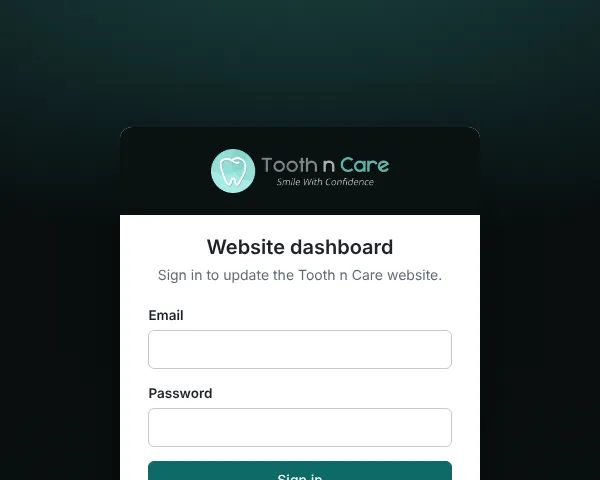
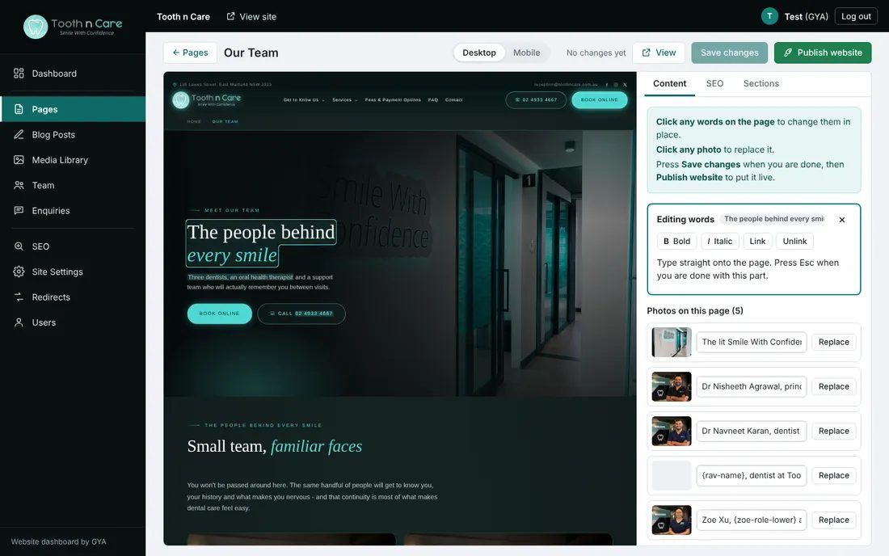
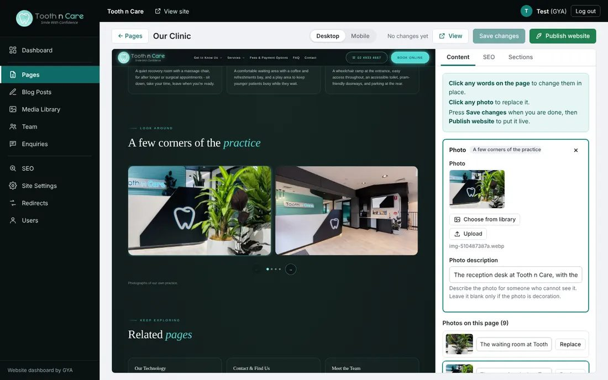
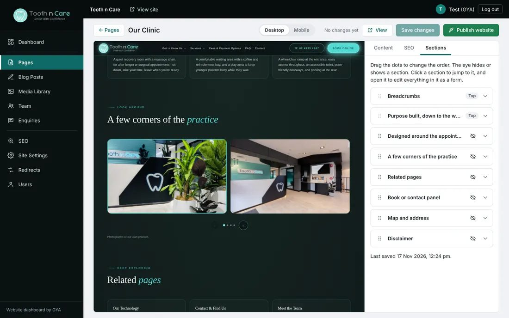
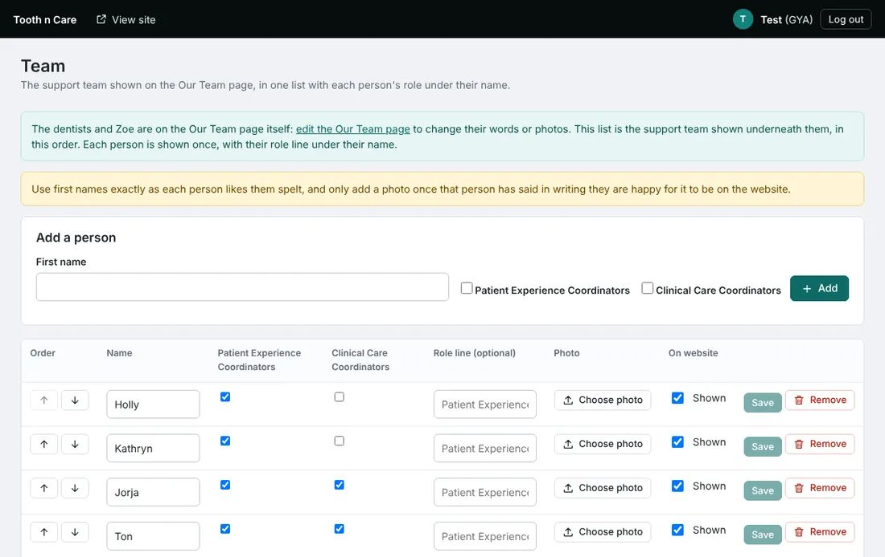

# Your website dashboard: the short guide

For Tooth n Care. The longer version, with every screen, is
`docs/HOW-TO-UPDATE.md`.

## 1. Signing in

Go to **www.toothncare.com.au/admin** (until the new website is live, the
preview address GYA sends you, followed by **/admin**). Sign in with your email
address and the temporary password from GYA. The first time, you choose your
own password: at least 10 characters, with letters and numbers.

**Forgotten your password?** Email GYA. We set a new temporary password and you
choose your own again when you next sign in.

## 2. Changing wording

**Pages**, then the page. The page appears as it looks on the website.
**Click any words** and type. Bold, italic and links are in the box on the
right. Press **Esc** when done, then **Save changes**.

Shaded words (the phone number, opening hours, Dr Rav's name, AHPRA numbers)
fill in from one place so they match everywhere. Leave them as they are and
email GYA to change them.

## 3. Swapping a photo

**Click the photo** on the page, then **Upload** (or **Choose from library**).
Describe the photo in a few words for people who cannot see it. Then **Save
changes**.

Tips: landscape photos work best; at least 1600 pixels wide for the big photos
at the top of a page; avoid writing or signs at the very edges, as phones show
a narrower slice. Only photos the practice owns, and only of people who have
agreed in writing.

To hide a section or change the order of sections, use the **Sections** tab:
drag the dots to move one, the eye to hide or show it.

## 4. The team

**Team** in the menu is the support team on the Our Team page, in order, each
with their role under their name.

- **Add**: type the first name, tick their group (or both), **Add**.
- **Edit**: change the name, group or role line, then **Save** on that row.
- **Hide for now**: untick **On website**, then **Save**.
- **Reorder**: the arrows.
- **Photo**: **Choose photo**, then **Save**.

The dentists and Zoe are on the Our Team page itself: click their words or
photo there.

**Team photos:** landscape 4:3 (for example 1600 x 1200 pixels, at least
800 x 600), head and shoulders in the middle, a plain background such as a
wall in the practice. Upload it as it is: **the colour treatment is added
automatically**, so every card matches.

## 5. Putting it live

Nothing changes on the website until you press **Publish website** (top
right, or on the Dashboard). It goes live **a few minutes later**. Save as
often as you like before that. If something does not look right, email GYA:
nothing you do here can break the website.
