# Your website dashboard: the guide

For the Tooth n Care team. Version 2.9.1, November 2026. The printable copy is
`Tooth-n-Care-Website-Guide.pdf`. The longer version, with every screen, is
`docs/HOW-TO-UPDATE.md`.

Nothing you do in the dashboard can break the website. Changes are saved in
the dashboard first and only reach the website when you press **Publish
website**, so you can try things and look before anyone else sees them.

## 1. Signing in

Go to **www.toothncare.com.au/admin**. Sign in with your email address and the
temporary password GYA gives you (by phone or a one-time link, never in the
same email as your login). The first time, you choose your own password: at
least 10 characters, with letters and numbers. Each person has their own
login; please don't share one.

**Forgotten your password?** Ask GYA. We set a new temporary password and you
choose your own again when you next sign in.

**Signing out:** **Log out**, top right. Do this on a shared computer.

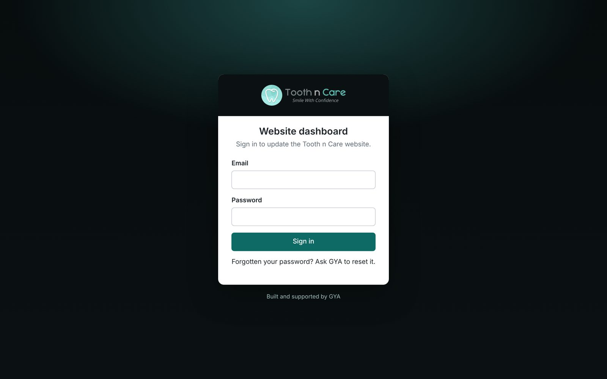

The **Dashboard** is the first screen: changes waiting to publish, the latest
enquiries, and quick links.

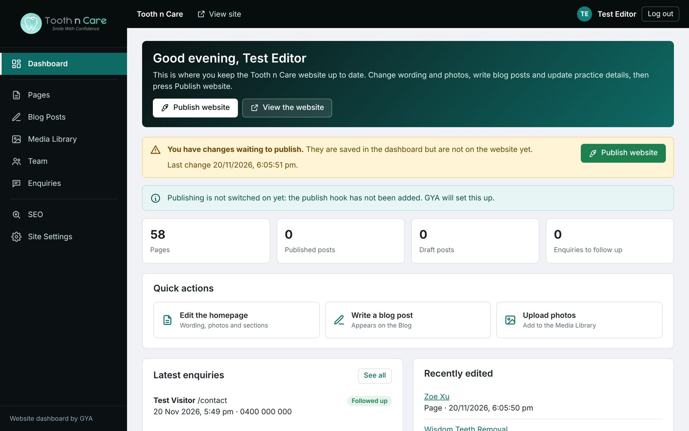

## 2. Photos

### The Media Library

**Media Library** in the menu holds every photo the website can use.

- **Add photos:** drag them onto the box, or **Upload from your computer**.
  JPG, PNG and WebP all work, and so do photos straight from a phone: large
  ones are made smaller automatically before they upload.
- **iPhone photos (HEIC):** most upload as they are. If one is refused, on the
  iPhone open **Settings, Camera, Formats** and choose **Most Compatible**, or
  email the photo to yourself and save it as a JPG.
- **Find a photo:** type in **Search photos**.
- **Describe a photo:** click it, type a few words for people who can't see it
  (for example "Reception desk with the aqua feature wall"), **Save
  description**.
- **Replace everywhere:** click the photo, **Upload a replacement**. The new
  photo takes its place on every page that uses it.
- **Delete:** click the photo, **Delete**. A photo that is still used on a page
  can't be deleted: the dashboard lists where it is used, so you can swap it
  there first.

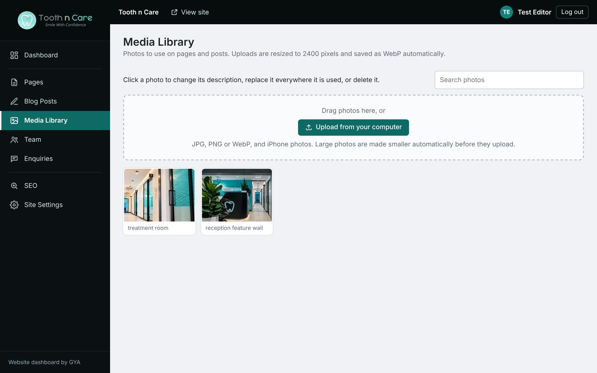

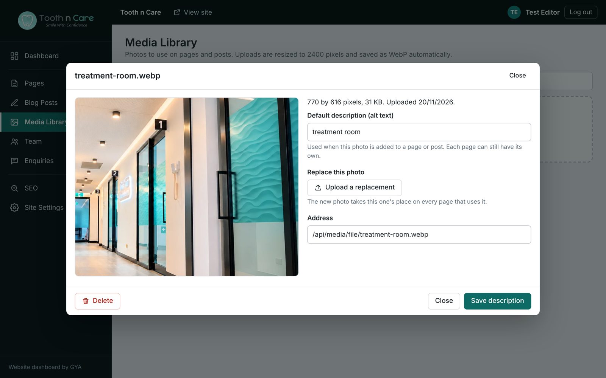

### Swapping a photo on one page

**Pages**, open the page, **click the photo**. Then **Choose from library** or
**Upload**, check the **Photo description**, and **Save changes**. Changed your
mind? **Put back the original photo**.

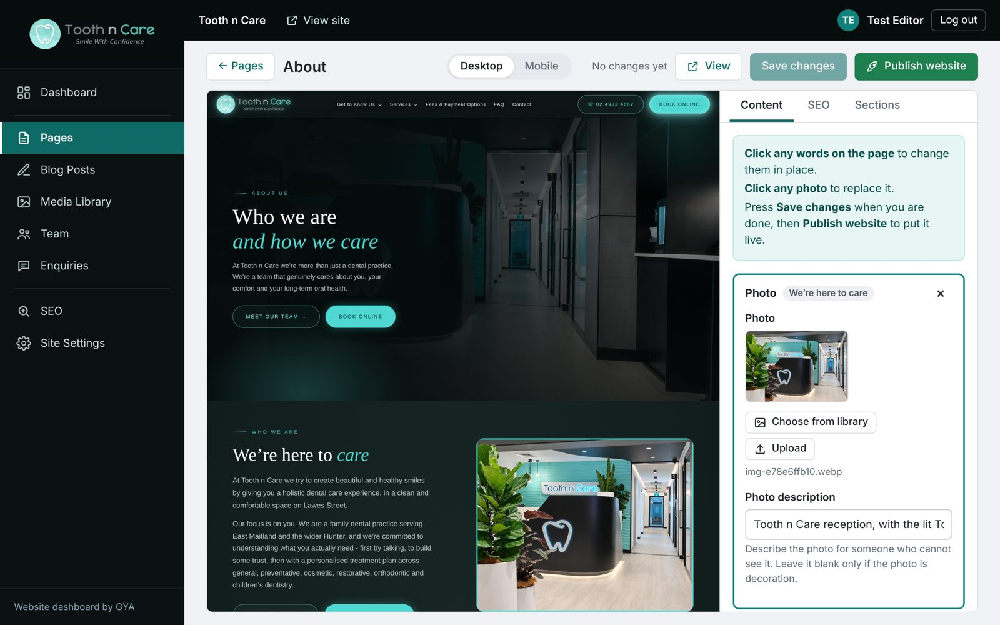

### Sizes

- Big photos at the top of a page: landscape, at least 1600 pixels wide. Keep
  faces and signs away from the edges, as phones show a narrower slice.
- Photos inside a page: landscape, at least 1200 pixels wide.
- Blog photos: landscape, at least 1200 pixels wide.

### Team photos

Landscape 4:3 (for example 1600 x 1200 pixels, at least 800 x 600), head and
shoulders in the middle, a plain background such as a wall in the practice.
Upload it as it is: **the colour treatment is added automatically**, so every
card matches. Only put a photo of someone on the website once they have said in
writing that they are happy for it to be there.

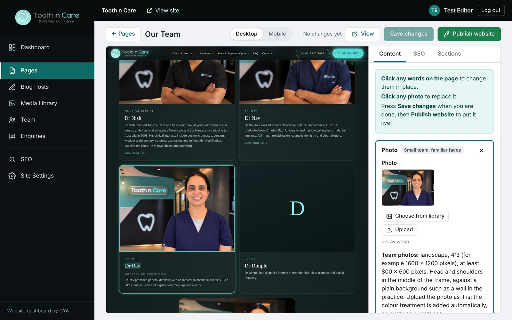

### Which photos you can use

- **Photos you own:** taken by the practice, or by a photographer you paid who
  has given the practice the right to use them online.
- **Stock photos:** only with a licence that covers websites, and keep the
  receipt. Never copy a photo from another website or from Google Images.
- **People:** written consent from everyone who can be recognised, including
  staff. Children only with a parent's written consent.
- **Patients and before-and-after photos:** please send these to GYA first
  rather than uploading them. AHPRA has strict rules: a real patient of the
  practice, written consent, the same angle and lighting before and after, no
  editing, and a note that results vary. We check each one before it goes up.

## 3. Wording

**Pages**, then **Edit** next to the page. The page appears as it looks on the
website.

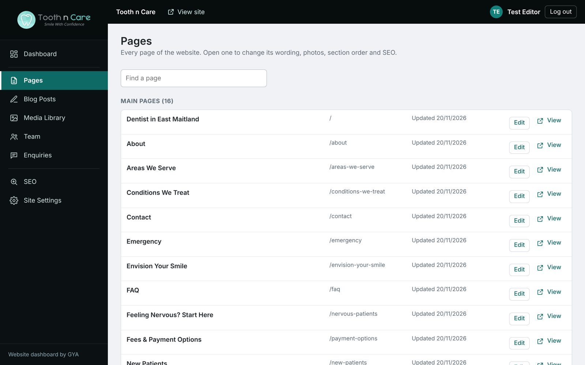

- **Change words:** click any words on the page and type. Bold, italic and
  links are in the box on the right. Press **Esc** when done.
- **Links:** select the words, **Link**, then the address (a page on the
  website starts with `/`, for example `/contact`).
- **Shaded words** (the phone number, email, address) fill in from **Site
  Settings** so they match everywhere. Change them there, not on the page.
- **Desktop / Mobile** (top) shows the page at phone size.
- **Save changes** keeps your work in the dashboard. If you try to leave with
  unsaved changes, the dashboard asks first.
- **View** opens the saved page as a preview.

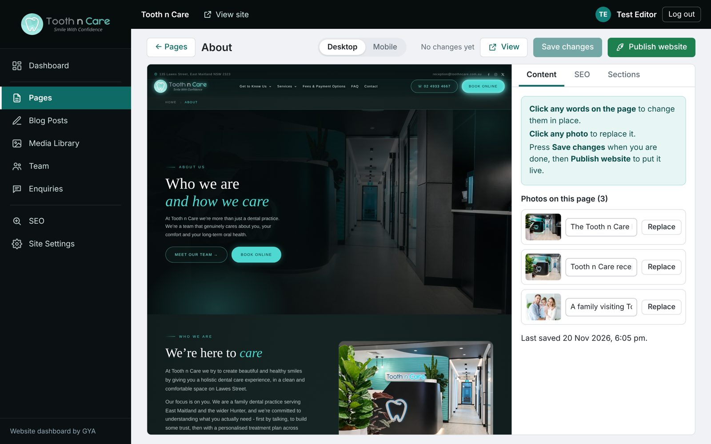

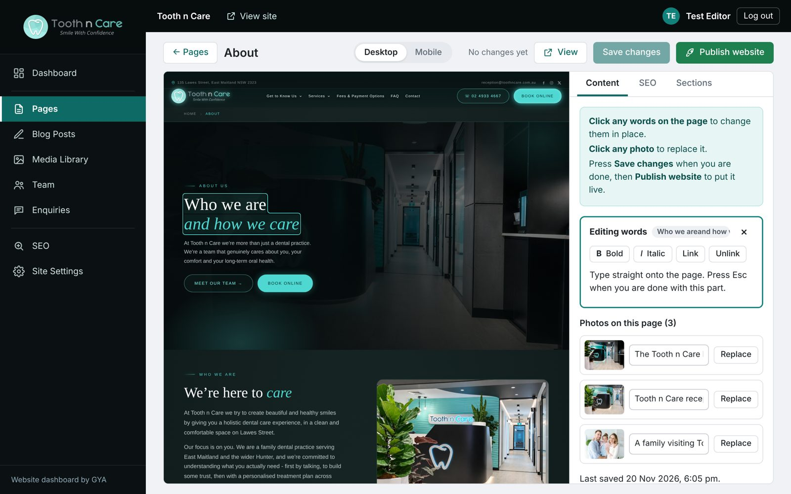

**Sections** (the tab on the right): drag the dots to change the order, the eye
to hide or show a section.

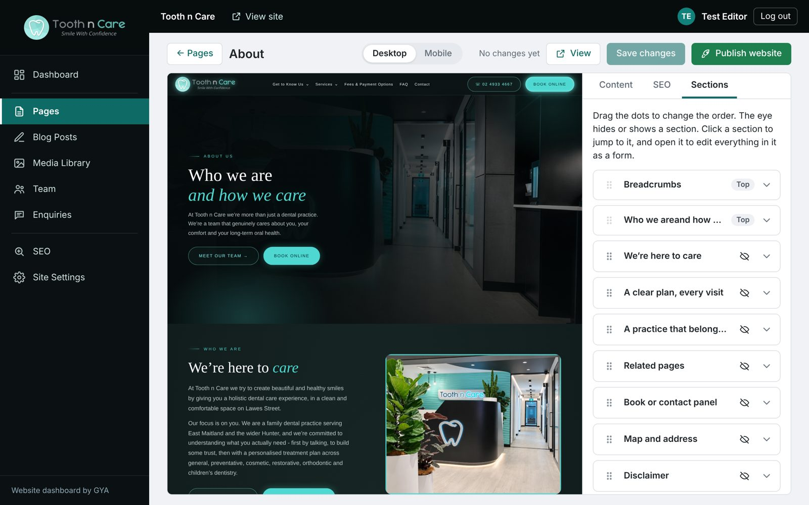

**SEO** (the tab on the right): the title and description Google shows, and the
picture shown when the page is shared. The page's address can't be changed
here: changing a page's address can affect Google rankings, so please ask GYA.

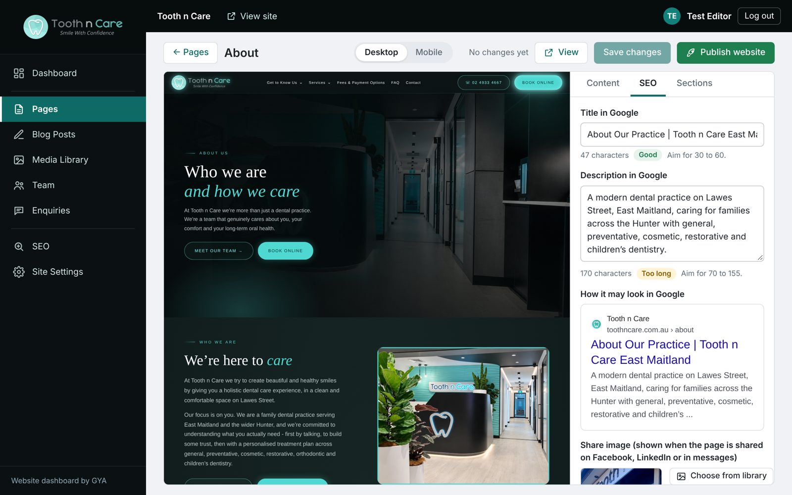

### Undo

- **Before you save:** **Ctrl+Z** (Windows) or **Cmd+Z** (Mac) while typing, or
  leave the page and choose not to save.
- **After saving, before publishing:** change it back and save again, or ask GYA
  to put the page back to how it was.
- **After publishing:** the same, then publish again. GYA can always put a page
  back to the last approved version.

### Putting it live

Nothing changes on the website until you press **Publish website** (top right
of any page, or on the Dashboard). The website updates **a few minutes later**.
Save as often as you like before that.

## 4. The team

**Team** in the menu is the support team on the Our Team page, in order, each
with their role under their name.

- **Add:** type the first name, tick their group (or both), **Add**.
- **Edit:** change the name, group or role line, then **Save** on that row.
- **Hide for now:** untick **On website**, then **Save**.
- **Reorder:** the arrows.
- **Photo:** **Choose photo**, then **Save**.

The dentists and Zoe are on the Our Team page itself: click their words or
photo there. Dentists' names, titles and registration details come from the
practice and are checked by GYA, so please ask GYA to change those.

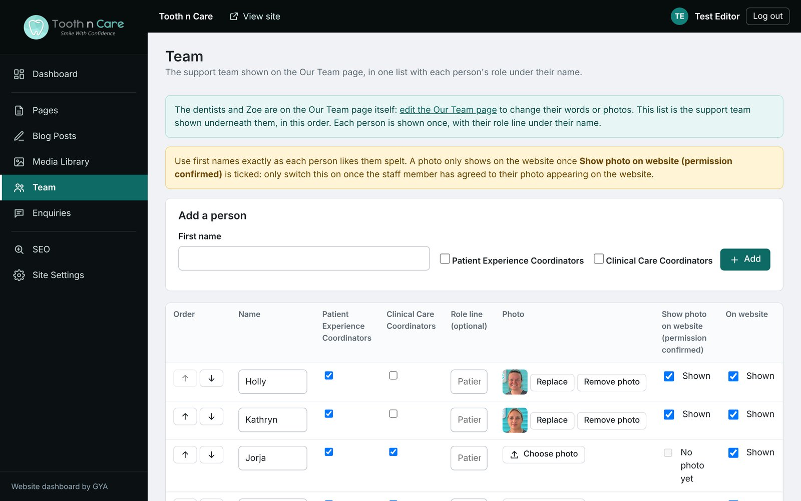

### Adding a new dentist's photo and bio

For a dentist who shows a letter instead of a photo (Dr Rav today):

1. **Team**, then **edit the Our Team page** (the link at the top), or
   **Pages**, **Our Team**.
2. **Photo:** click the letter on their card, then **Upload** (or **Choose from
   library**). Use a landscape photo, head and shoulders, plain background, at
   least 800 x 600 pixels. The colour treatment is added automatically. Check
   the **Photo description** (their name and "dentist at Tooth n Care").
3. **Bio:** click **Add words** under their name and type two or three
   sentences the dentist has written or approved. Leave it empty and nothing
   shows on the website.
4. **Save changes**.
5. Do the same on the **Home** page, in the team slider (their slide has the
   same letter and an **Add words** line).
6. **Publish website**.

Their name, title, qualifications and registration number come from the
practice in writing and are set by GYA, as is their own profile page: send
those to GYA.

## 5. The blog

**Blog Posts**, **Write a new post**.

1. **Title**. The web address fills in from it.
2. Write the post. The toolbar has **Heading**, **Subheading**, bold, italic,
   **Link**, **Bullet list**, **Numbered list**, **Quote** and **Photo** (from the
   Media Library), plus **Undo** and **Redo**.
3. **Featured photo** (shown at the top and on the Blog page), a **Summary for
   the blog list**, and in the SEO box, if you like, a **Share image** (shown
   when the post is shared on Facebook and the like).
4. **Publish this post**, then **Publish website**. A few minutes later it is
   on the Blog page and in the sitemap Google reads.

To take a post down: open it, **Unpublish (make it a draft)**, then **Publish
website**. **Delete post** removes it for good.

The reminder at the top of the screen lists the advertising rules (see
section 8).

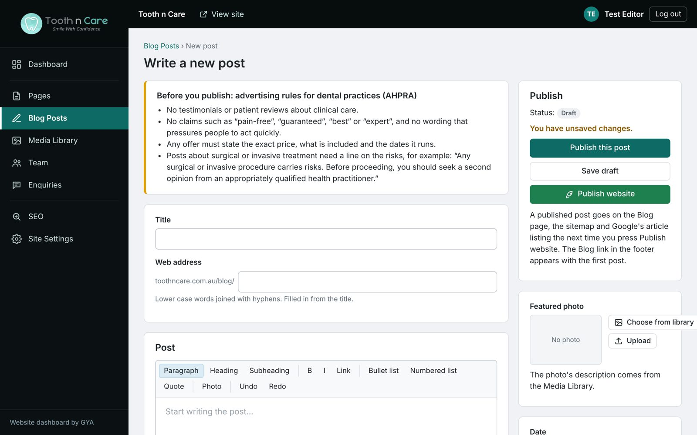

## 6. Enquiries

Every message sent through the website's form is kept under **Enquiries**, as
well as being emailed to reception, so a lead is never lost even if an email
goes astray.

- **Followed up:** tick it once someone has called or emailed back.
  **Not followed up** shows only the ones still waiting.
- **Notes:** click the name to open the enquiry and add a note (for example
  "Called back, booked Tuesday").
- **Download for Excel (CSV):** every enquiry in a spreadsheet.

Enquiries hold personal information: please don't forward them outside the
practice, and don't send clinical details by email.

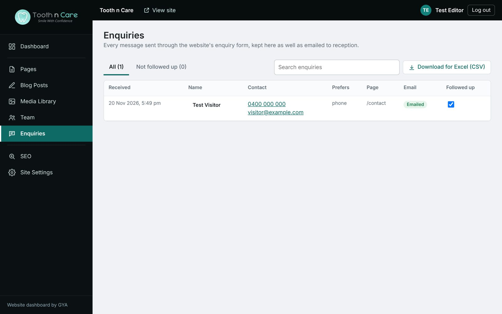

## 7. Site Settings, SEO and what to ask GYA

**Site Settings** holds the practice details used across the whole website:
practice name, phone, email, address, booking link, map and social links.
Change a detail once there and it changes everywhere, then **Publish
website**.

- **Opening hours** are in the footer of every page and on the Contact page.
  Open any page, click the hours in the footer and type the new ones (one change
  updates every page), then change them on the Contact page the same way.
- **Health funds** are part of the approved wording on the Payment Options page
  and a few other sections, so they are not set here. Ask GYA to change the
  list, so it changes everywhere it appears.

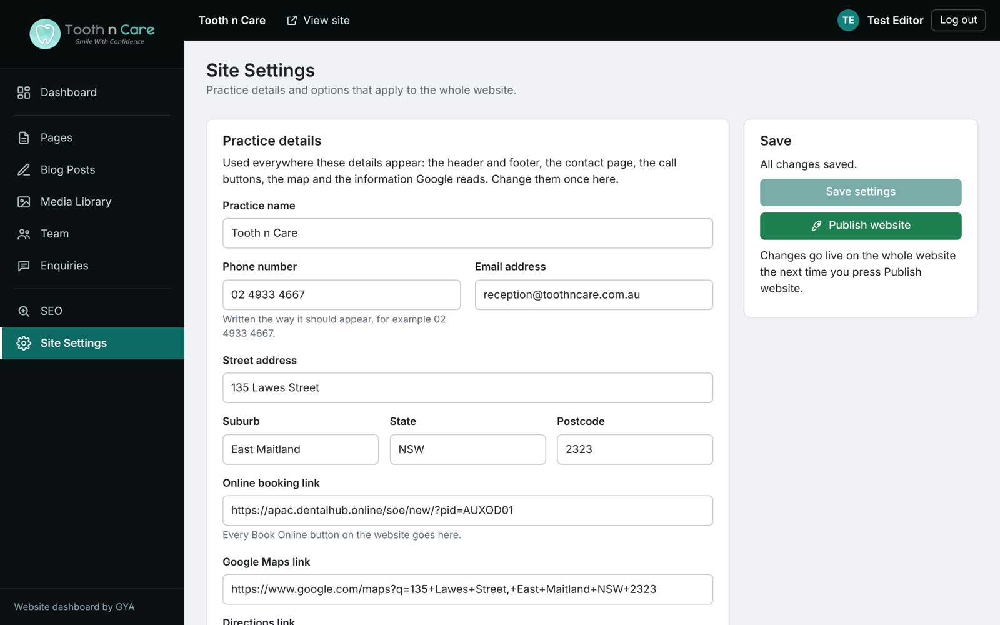

**SEO** in the menu lists every page with a quick verdict on its Google title
and description.

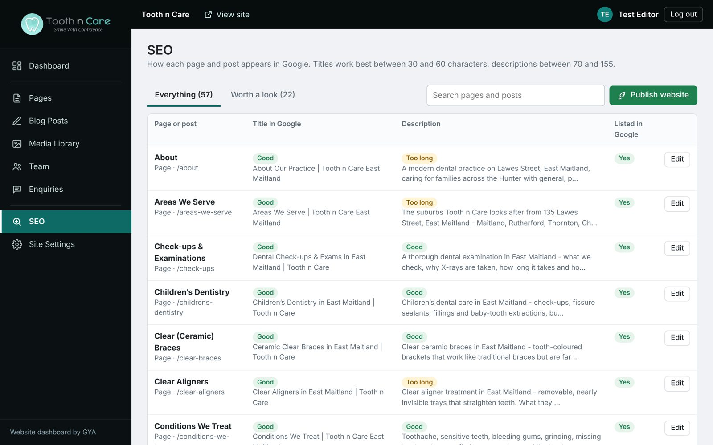

**Please ask GYA for:**

- a new page, or changing a page's web address
- offers and prices (the offer period and terms have to be on the website)
- anything about dentists' names, titles, qualifications or registration
- the Privacy Policy and Terms
- adding or removing a dashboard login
- where enquiry emails go
- before-and-after or patient photos
- anything that looks wrong after publishing

GYA: rowayne@gyaclients.com

## 8. Advertising rules (AHPRA): a reminder

Dental websites are advertising under the National Law. In short:

- No testimonials or reviews about clinical care, including quotes from
  patients on a page or in a post.
- No "pain-free", "painless", "guaranteed", "best", "leading", "expert" or
  "specialist" (unless the dentist is a registered specialist), and nothing
  that promises a result.
- Any offer must show the price, what is included and the offer period. No
  "limited time", "book now before it's gone" or similar pressure.
- Treatment that involves surgery or is invasive needs a line on the risks:
  "Any surgical or invasive procedure carries risks. Before proceeding, you
  should seek a second opinion from an appropriately qualified health
  practitioner."
- Before-and-after photos only as described in section 2.

If you are unsure about some wording, save it without publishing and ask GYA.
